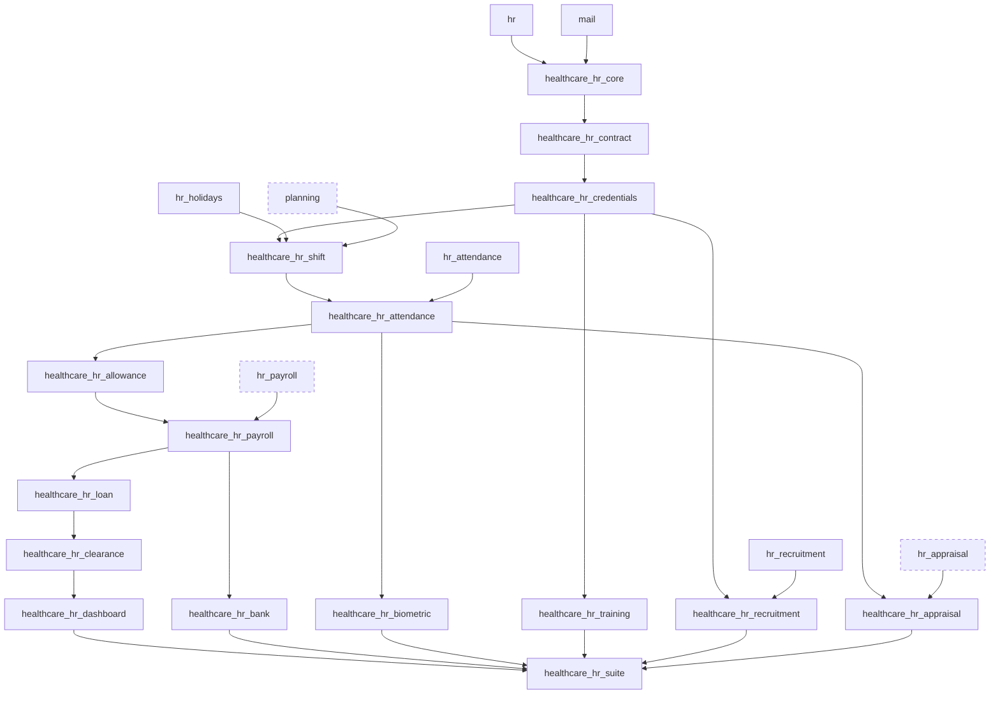
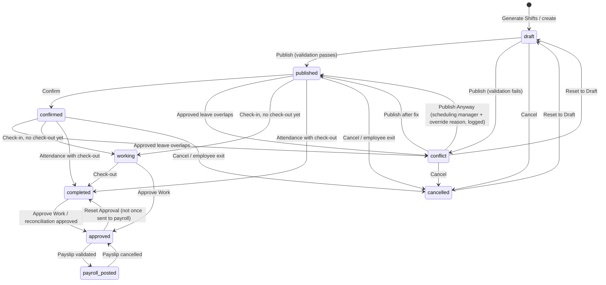
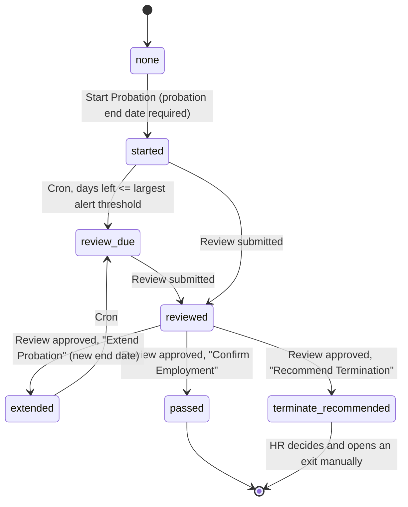
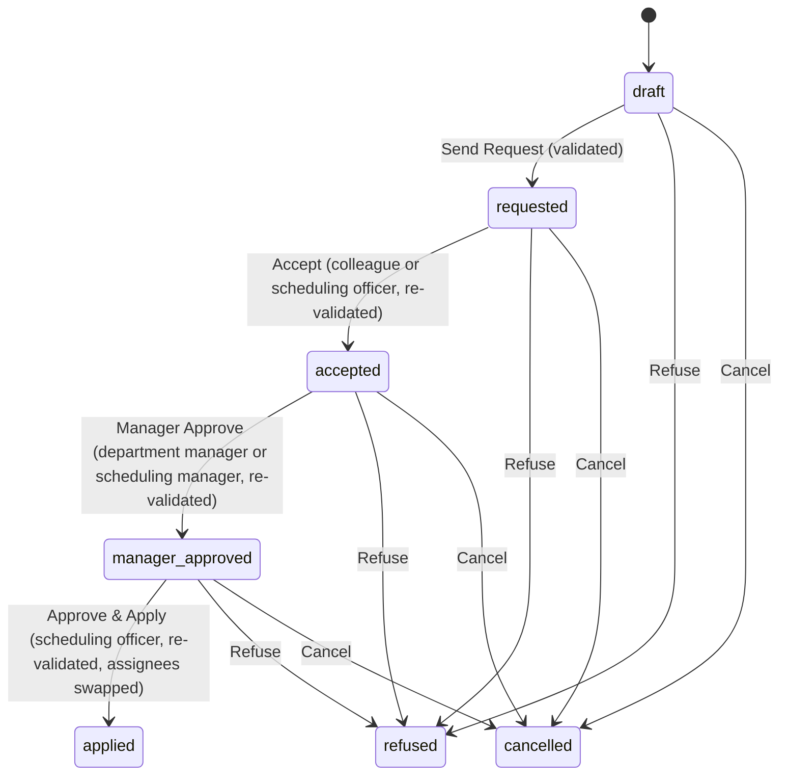
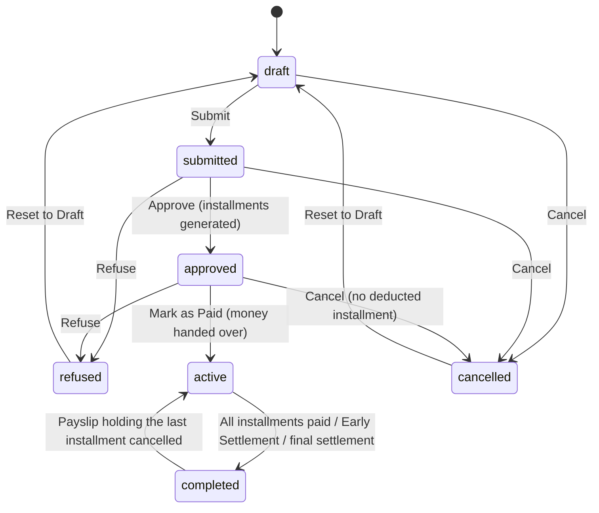
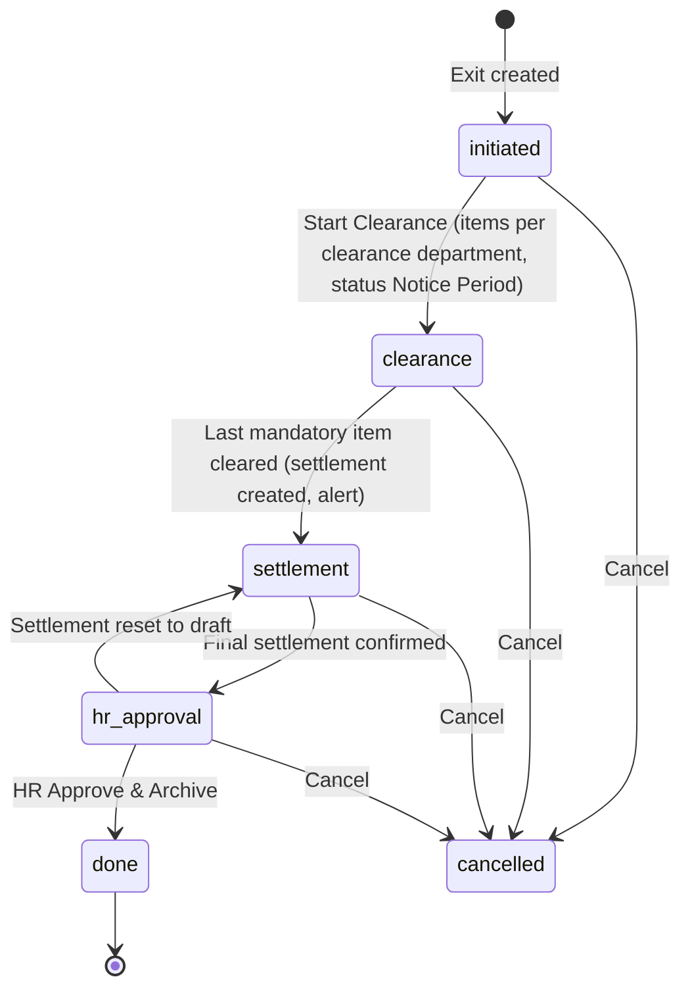
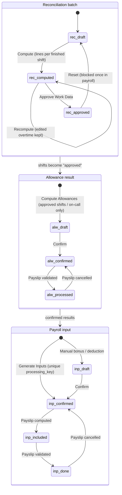
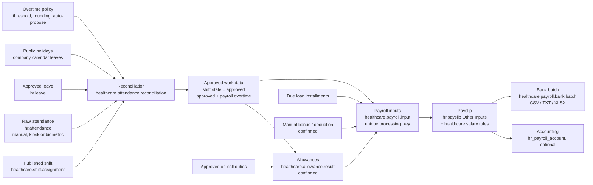

# Architecture: Healthcare HR Management Suite (Odoo 19)

This document is the implementation analysis requested in section 59 of the requirements
(`Odoo19_Healthcare_HR_Claude_Implementation_Prompt.md`) and the module-dependency documentation
requested in section 53. Everything here describes the code in
`custom_addons/healthcare_hr_*`, version `19.0.1.0.0`.

**Design rule:** the suite is a *healthcare workforce layer on top of standard Odoo 19 HR*. It never
forks or patches core code. It extends standard models with `_inherit`, reuses standard engines
(payroll, attendance, leave, planning, recruitment, appraisal) and adds custom models only for
healthcare-specific concepts.

Contents

1. [Standard Odoo modules reused](#1-standard-odoo-modules-reused)
2. [Standard Odoo models inherited](#2-standard-odoo-models-inherited)
3. [New custom models](#3-new-custom-models)
4. [Fields added to standard models](#4-fields-added-to-standard-models)
5. [Module dependency graph](#5-module-dependency-graph)
6. [Workflow map](#6-workflow-map)
7. [Security matrix](#7-security-matrix)
8. [Upgrade risks](#8-upgrade-risks)
9. [Performance risks and mitigations](#9-performance-risks-and-mitigations)
10. [Requirements already covered by standard Odoo](#10-requirements-already-covered-by-standard-odoo)
11. [Data flow: from shift to bank](#11-data-flow-from-shift-to-bank)
12. [Scheduled jobs (crons)](#12-scheduled-jobs-crons)
13. [Odoo 19 findings that shaped the design](#13-odoo-19-findings-that-shaped-the-design)
14. [Module decisions against the requested list](#14-module-decisions-against-the-requested-list)

---

## 1. Standard Odoo modules reused

| Standard module | Edition | Used by | What the suite reuses |
|---|---|---|---|
| `hr` | Community | core and all modules | Employees, departments, jobs, employee versions (`hr.version` = contract), contract types, departure reasons, working schedules |
| `mail` | Community | core and all modules | Chatter, tracking, activities (all alerts are `mail.activity` To-Dos) |
| `hr_holidays` | Community | shift | Leave requests and approvals; leave menus reused under **Healthcare HR > Leave** |
| `hr_attendance` | Community | attendance | `hr.attendance` check-in/check-out records, attendance groups |
| `hr_recruitment` | Community | recruitment | Applicant pipeline, stages, `create_employee_from_applicant` |
| `resource` | Community (via `hr`) | shift, attendance | Company working schedule (weekend days) and company calendar leaves (public holidays) |
| `planning` | Enterprise | shift | Published shifts are mirrored as `planning.slot` records (Gantt) |
| `hr_payroll` | Enterprise | payroll | Payslips, pay runs, salary structures, salary rules, `hr.payslip.input.type`, "Other Inputs" |
| `hr_appraisal` | Enterprise | appraisal | Appraisal records, appraisal groups and menus |

`hr_payroll_account` (payslip accounting entries) is **not** a dependency. When you install it, the
payslips produced with healthcare inputs post to accounting through the standard flow.

## 2. Standard Odoo models inherited

| Standard model | Inherited in | Why |
|---|---|---|
| `hr.employee` | core, contract, credentials, shift, training, loan, appraisal | Healthcare identity, organisation, clinical data, scheduling authorisations, smart buttons |
| `hr.version` | contract | Odoo 19 carries the contract on the employee version: probation, renewal policy, licence flags, alerts |
| `hr.department` | core | Link to branch, healthcare department type, units |
| `hr.job` | core | Default healthcare category, licence requirement |
| `res.users` | core | Allowed healthcare branches for record rules |
| `res.company` | core, shift, attendance, payroll | Alert thresholds, scheduling limits, overtime policy, payroll rate settings |
| `res.config.settings` | core, shift, attendance, payroll | **Settings > Healthcare HR** blocks |
| `hr.leave` | shift | Approved leave after publication flags overlapping shifts as conflicts |
| `hr.attendance` | attendance | Match to planned shift, late/early/extra time, night/weekend/holiday hours, status |
| `hr.payslip` | payroll | Healthcare inputs injected as standard "Other Inputs"; source lifecycle on validate/cancel/draft |
| `hr.payslip.input.type` | payroll | Marks the input types owned by the suite |
| `hr.payroll.structure` | payroll | Button that adds one salary rule per healthcare input type |
| `hr.applicant` | recruitment | Healthcare applicant data, credential verification gate, handover to employee |
| `hr.recruitment.stage` | recruitment | "Credential Verification" stage flag |
| `hr.appraisal` | appraisal | Healthcare KPI template, KPI lines, weighted score |

Custom models of one suite module are also extended by later modules (for example
`healthcare.shift.assignment` gains attendance fields in `healthcare_hr_attendance`).

## 3. New custom models

| Model | Module | Purpose |
|---|---|---|
| `healthcare.hr.branch` | core | Hospital / clinic / medical centre / branch hierarchy (`_parent_store`); a record without parent is a facility |
| `healthcare.hr.unit` | core | Clinical or administrative unit inside a department (ICU bay, ER triage, X-Ray) |
| `healthcare.medical.specialty` | core | Specialty and sub-specialty tree (22 records shipped) |
| `healthcare.employee.practitioner.link` | core | Loose bridge between an employee and an external or Odoo practitioner record (EMR, LIS, RIS, PACS, pharmacy) |
| `healthcare.hr.onboarding.item.template` | core | Configurable onboarding checklist items (13 shipped) |
| `healthcare.hr.onboarding` / `.line` | core | Onboarding checklist per employee, with progress |
| `healthcare.hr.alert` (abstract) | core | Idempotent activity scheduling service used by every cron |
| `healthcare.hr.probation.review` | contract | Probation review with scores and recommendation; never terminates automatically |
| `healthcare.hr.contract.renew.wizard` (transient) | contract | Renew a contract by creating a new employee version |
| `healthcare.hr.credential.type` | credentials | License, certification, permit or insurance type; mandatory flag, scope, "blocks shift assignment" |
| `healthcare.hr.credential` | credentials | Employee credential with number, authority, dates, documents, verification and computed status |
| `healthcare.shift.template` | shift | Shift definition (times, midnight crossing, break, grace, rest, allowed jobs, branch) |
| `healthcare.shift.assignment` | shift | One employee on one shift on one date, stored in UTC, with planned and actual hours and a 9-state workflow |
| `healthcare.shift.validator` (abstract) | shift | Batch validation engine run before publishing and before applying swaps |
| `healthcare.shift.coverage.rule` | shift | Minimum / preferred staffing per branch, department, unit, template, category or job |
| `healthcare.shift.coverage.snapshot` | shift | Staffing level per rule and day (stored for pivots and shortage alerts) |
| `healthcare.shift.swap` | shift | Shift swap or one-way hand-over with colleague, manager and scheduling approval |
| `healthcare.shift.oncall` | shift | On-call duty with standby hours and call-in tracking |
| `healthcare.shift.publish.wizard` / `.generate.wizard` (transient) | shift | Publish a roster period with coverage check; generate draft shifts |
| `healthcare.attendance.reconciliation` / `.line` | attendance | Batch that turns shifts + attendance + leave + holidays + overtime policy into approved work data |
| `healthcare.biometric.device` | biometric | Time clock: vendor, connection type (push, pull, file, SDK), hashed push token, device timezone |
| `healthcare.biometric.employee.mapping` | biometric | Device employee code to employee (device-specific or company-wide) |
| `healthcare.biometric.log` | biometric | Raw punch as received; deduplicated per (device, code, timestamp); processed into attendance |
| `healthcare.biometric.sync.batch` | biometric | One import run with received / created / duplicate / processed / pending / failed counters and error log |
| `healthcare.biometric.import.wizard` (transient) | biometric | CSV punch import |
| `healthcare.allowance.type` | allowance | Allowance category (16 shipped), taxable flag, payroll input mapping |
| `healthcare.allowance.rule` | allowance | Filters and calculation method (fixed, per shift, per hour, % basic, % gross, formula), min/max |
| `healthcare.allowance.result` | allowance | Computed amount per employee, rule and period, linked to the shifts and on-call duties used |
| `healthcare.allowance.compute.wizard` (transient) | allowance | Compute (and optionally confirm) allowances for a period |
| `healthcare.payroll.input` | payroll | Staging record for payroll with a unique `processing_key`, period, source model and record |
| `healthcare.payroll.input.generate.wizard` (transient) | payroll | Compute allowances and generate inputs for a period |
| `healthcare.hr.loan` / `.installment` | loan | Loan or salary advance, approval workflow and installment schedule |
| `healthcare.training.requirement` | training | Training requirement matrix line (job / category / department to credential type) |
| `healthcare.training.assignment` | training | Training assigned to an employee; completion creates or renews the credential |
| `healthcare.training.compliance.report` (SQL view) | training | Employee x requirement compliance matrix |
| `healthcare.appraisal.kpi.template` / `.line` | appraisal | KPI templates per category or job, weights summing to 100 |
| `healthcare.appraisal.kpi.line` | appraisal | KPI lines on an appraisal, manual or computed |
| `healthcare.applicant.credential` | recruitment | Credential lines of an applicant, with verification |
| `healthcare.hr.clearance.department` | clearance | Configurable clearance departments (7 shipped) |
| `healthcare.hr.exit` | clearance | Exit workflow from initiation to archive |
| `healthcare.hr.clearance.item` | clearance | Clearance task per department, with obligation amount |
| `healthcare.hr.settlement.component` | clearance | Configurable final settlement component (11 shipped) |
| `healthcare.hr.final.settlement` / `.line` | clearance | Final settlement with computed lines and a PDF report |
| `healthcare.payroll.bank.layout` / `.column` | bank | Bank file layout: format, delimiter, widths, padding, decimals, encoding, date format |
| `healthcare.payroll.bank.batch` / `.line` | bank | Salary transfer batch built from validated payslips |
| `healthcare.hr.dashboard` (transient) | dashboard | KPI tiles computed on open, with drill-down |

## 4. Fields added to standard models

Standard fields are reused wherever they exist: national ID (`identification_id`), passport
(`passport_id`), nationality (`country_id`), contract dates, wage and contract type (`hr.version`),
trial period end (`trial_date_end`), departure date and reason, bank accounts.

### `hr.employee`

| Module | Fields |
|---|---|
| core | `employee_number` (sequence `EMP-00001`, unique per company), `arabic_name`, `hire_date`, `employee_category`, `is_clinical` (stored), `employment_status` (onboarding, probation, active, suspended, notice, exited), `healthcare_branch_id`, `healthcare_unit_id`, `medical_department_id`, `medical_specialty_id`, `sub_specialty_id`, `practitioner_reference`, `professional_registration_number`, `practitioner_link_ids`, `onboarding_ids` |
| contract | `probation_status`, `probation_start_date`, `renewal_type`, `medical_license_required`, `professional_license_required`, `insurance_required` (all related to the current version) |
| credentials | `credential_ids`, `credential_count`, `credential_issue_count` |
| shift | `allow_24h_shift`, `weekend_work_allowed` (default on), `max_weekly_hours`, `shift_assignment_ids` |
| training | `training_assignment_ids`, `training_open_count` |
| loan | `loan_ids`, `loan_remaining_amount` (payroll officers only) |

### Other standard models

| Model | Module | Fields |
|---|---|---|
| `hr.version` | contract | `probation_start_date`, `probation_end_date` (related to `trial_date_end`), `probation_status`, `probation_review_ids`, `renewal_type`, `renewal_period_months`, `renewal_notice_days`, `contract_expiry_alert_days`, `medical_license_required`, `professional_license_required`, `insurance_required` |
| `hr.department` | core | `healthcare_branch_id`, `healthcare_department_type`, `healthcare_unit_ids` |
| `hr.job` | core | `employee_category`, `medical_license_required` |
| `res.users` | core | `healthcare_branch_ids` (empty = all branches) |
| `res.company` | core | `hc_probation_alert_days` (`30,14,7`), `hc_contract_alert_days` (60), `hc_credential_alert_days` (`90,60,30,7`), `hc_training_alert_days` (30), `hc_alert_user_id` |
| `res.company` | shift | `hc_night_start` (22.0), `hc_night_end` (6.0), `hc_max_weekly_hours` (60), `hc_max_shift_hours` (24), `hc_default_rest_hours` (8), `hc_shift_match_window` (3 h) |
| `res.company` | attendance | `hc_overtime_min_minutes` (30), `hc_overtime_rounding_minutes` (15), `hc_overtime_auto_propose` (on), `hc_missing_checkout_hours` (2) |
| `res.company` | payroll | `hc_overtime_rate` (1.25), `hc_payroll_monthly_hours` (empty = from working schedule) |
| `hr.attendance` | attendance | `planned_shift_id`, `scheduled_start`, `scheduled_end`, `planned_hours`, `branch_id`, `late_minutes`, `early_leave_minutes`, `extra_time_hours`, `night_hours`, `weekend_hours`, `holiday_hours`, `attendance_status`, `reconciliation_state` |
| `hr.payslip` | payroll | `healthcare_branch_id`, `healthcare_input_ids` |
| `hr.payslip.input.type` | payroll | `healthcare_source_type`, `healthcare_is_deduction` |
| `hr.appraisal` | appraisal | `hc_kpi_template_id`, `hc_kpi_line_ids`, `hc_period_start`, `hc_period_end`, `hc_kpi_score` |
| `hr.applicant` | recruitment | `arabic_name`, `healthcare_specialty_id`, `years_experience`, `professional_license`, `classification`, `employee_category`, `required_credential_type_ids`, `hc_credential_line_ids`, `credential_verification_status`, `hc_verification_failed`, `hc_verification_note` |
| `hr.recruitment.stage` | recruitment | `hc_credential_verification` |

### Suite models extended by later modules

| Model | Extended by | Fields |
|---|---|---|
| `healthcare.shift.assignment` | attendance | `attendance_ids`, `attendance_status`, `late_minutes`, `early_leave_minutes` |
| `healthcare.shift.template` | allowance | `allowance_rule_ids` |
| `healthcare.allowance.type` | payroll | `payslip_input_type_id` |
| `healthcare.hr.credential.type` | training | `training_requirement_ids` |
| `healthcare.payroll.input` | loan | Loan installments added to the collected sources |

## 5. Module dependency graph

Enterprise modules are shown with a dashed border.



Text tree (each module lists its direct `depends`):

```text
healthcare_hr_core ............ hr, mail
└── healthcare_hr_contract .... healthcare_hr_core
    └── healthcare_hr_credentials .... healthcare_hr_contract
        ├── healthcare_hr_training ....... healthcare_hr_credentials
        ├── healthcare_hr_recruitment .... healthcare_hr_credentials, hr_recruitment
        └── healthcare_hr_shift .......... healthcare_hr_credentials, hr_holidays, planning
            └── healthcare_hr_attendance ..... healthcare_hr_shift, hr_attendance
                ├── healthcare_hr_biometric .... healthcare_hr_attendance   (python: requests)
                ├── healthcare_hr_appraisal .... healthcare_hr_attendance, hr_appraisal
                └── healthcare_hr_allowance .... healthcare_hr_attendance
                    └── healthcare_hr_payroll ...... healthcare_hr_allowance, hr_payroll
                        ├── healthcare_hr_bank ......... healthcare_hr_payroll
                        └── healthcare_hr_loan ......... healthcare_hr_payroll
                            └── healthcare_hr_clearance .... healthcare_hr_loan
                                └── healthcare_hr_dashboard .... healthcare_hr_clearance

healthcare_hr_suite (meta, application) .... all 15 modules above
```

Soft dependencies (no manifest dependency, detected at runtime):

- The dashboard shows the training tiles only when `healthcare_hr_training` is installed.
- Appraisal training compliance uses the training matrix when `healthcare_hr_training` is installed,
  and the mandatory credential types otherwise.

## 6. Workflow map

### 6.1 Shift assignment



`approved` and `payroll_posted` shifts are locked: employee, template, date, times and approved
overtime cannot change, and they cannot be cancelled or deleted. Only draft, conflicting or cancelled
shifts can be deleted.

A reconciliation also picks up `conflict` shifts that were actually worked (they have attendance), so
work done on an unpublished shift is not lost; approving the reconciliation moves them to `approved`.

### 6.2 Probation



Starting probation sets the employee status to *On Probation*; passing sets it back to *Active*.
A termination recommendation only raises an activity: it never archives the employee.

### 6.3 Shift swap



Every step re-runs the validation engine on the hypothetical swapped roster. The colleague must be in
the same healthcare category and belong to the shift's department.

### 6.4 Loan and salary advance



The `paid` state exists in the selection list, but the **Mark as Paid** button moves an approved loan
directly to `active`. A salary advance is limited to 3 installments.

Installment states: `pending` → `included` (in a payslip) → `paid` (payslip validated); cancelling the
payslip returns it to `pending`. **Postpone** moves a pending installment one month after the last one.

### 6.5 Employee exit, clearance and final settlement



HR approval ends the contract on the last working date, cancels future shifts (never deletes them),
sets the employee to *Exited* with the standard departure date and reason, and archives the employee.

Final settlement: `draft` → **Compute** → `computed` → **Confirm** → `confirmed` → **Mark as Paid**
→ `paid`. Marking it paid closes pending payroll inputs and settles active loans.

### 6.6 Reconciliation to payroll



Approving a reconciliation writes, per shift: approved overtime, payroll overtime (approved overtime
rounded down to the company step), final attendance status, and state `approved`.

## 7. Security matrix

### 7.1 Groups

All groups live in the **Healthcare HR** category and use Odoo 19 `res.groups.privilege` records.

| Group | Privilege | Implies |
|---|---|---|
| Employee Self Service | (none) | implied by every internal user (`base.group_user`) |
| Healthcare HR User | Healthcare HR | Internal User |
| Healthcare HR Officer | Healthcare HR | HR User, `hr.group_hr_user` |
| Healthcare HR Manager | Healthcare HR | HR Officer, `hr.group_hr_manager` |
| Attendance Officer | Healthcare Attendance | HR User, `hr_attendance.group_hr_attendance_user` |
| Attendance Manager | Healthcare Attendance | Attendance Officer, `hr_attendance.group_hr_attendance_manager` |
| Scheduling Officer | Workforce Scheduling | HR User |
| Scheduling Manager | Workforce Scheduling | Scheduling Officer |
| Payroll Officer | Healthcare Payroll | HR User, `hr_payroll.group_hr_payroll_user` |
| Payroll Manager | Healthcare Payroll | Payroll Officer, `hr_payroll.group_hr_payroll_manager` |
| Training Officer | Healthcare Talent | HR User |
| Recruitment Officer | Healthcare Talent | Training Officer, `hr_recruitment.group_hr_recruitment_user` |
| Department Manager | Healthcare Management | HR User |
| Hospital Director | Healthcare Management | Department Manager |
| System Administrator | Healthcare Management | Director, HR Manager, Attendance Manager, Scheduling Manager, Payroll Manager, Recruitment Officer (granted to `admin` and `__system__`) |

### 7.2 Access rights (effective, including implied groups)

R = read, W = write, C = create, D = delete, "-" = no access. Record rules further restrict the rows
(see 7.3). Abbreviations: ESS = Employee Self Service, Usr = HR User, Off = HR Officer, Mgr = HR
Manager, AtO/AtM = Attendance Officer/Manager, ScO/ScM = Scheduling Officer/Manager, PyO/PyM =
Payroll Officer/Manager, TrO = Training Officer, RcO = Recruitment Officer, DM = Department Manager,
Dir = Hospital Director, Adm = System Administrator.

| Model | ESS | Usr | Off | Mgr | AtO | AtM | ScO | ScM | PyO | PyM | TrO | RcO | DM | Dir | Adm |
|---|---|---|---|---|---|---|---|---|---|---|---|---|---|---|---|
| Branch / Unit / Specialty | R | R | R | RWCD | R | R | R | R | R | R | R | R | R | R | RWCD |
| Onboarding | - | R | RWCD | RWCD | R | R | R | R | R | R | R | R | R | R | RWCD |
| Probation review | - | - | RWCD | RWCD | - | - | - | - | - | - | - | - | RWC | RWC | RWCD |
| Credential type | R | R | R | RWCD | R | R | R | R | R | R | R | R | R | R | RWCD |
| Credential | R | R | RWCD | RWCD | R | R | R | R | R | R | R | R | R | R | RWCD |
| Shift template | R | R | R | R | R | R | R | RWCD | R | R | R | R | R | R | RWCD |
| Shift assignment | R | R | R | R | RW | RW | RWCD | RWCD | R | R | R | R | R | R | RWCD |
| Coverage rule | - | R | R | R | R | R | R | RWCD | R | R | R | R | R | R | RWCD |
| Shift swap | RWC | RWC | RWC | RWC | RWC | RWC | RWCD | RWCD | RWC | RWC | RWC | RWC | RWC | RWC | RWCD |
| On-call duty | R | R | R | R | R | R | RWCD | RWCD | R | R | R | R | R | R | RWCD |
| Attendance reconciliation | - | R | R | R | RWCD | RWCD | R | R | R | R | R | R | R | R | RWCD |
| Biometric device | - | - | - | - | R | RWCD | - | - | - | - | - | - | - | - | RWCD |
| Biometric log / sync batch | - | - | - | - | RW | RWC | - | - | - | - | - | - | - | - | RWCD |
| Allowance rule | - | - | - | - | - | - | - | - | R | RWCD | - | - | - | - | RWCD |
| Allowance result | - | - | - | - | - | - | - | - | RWCD | RWCD | - | - | - | - | RWCD |
| Payroll input | - | - | - | - | - | - | - | - | RWCD | RWCD | - | - | - | - | RWCD |
| Loan | RWC | RWC | RWC | RWC | RWC | RWC | RWC | RWC | RWCD | RWCD | RWC | RWC | RWC | RWC | RWCD |
| Bank layout | - | - | - | - | - | - | - | - | R | RWCD | - | - | - | - | RWCD |
| Bank batch / line | - | - | - | - | - | - | - | - | RWCD | RWCD | - | - | - | - | RWCD |
| Training requirement | R | R | R | RWCD | R | R | R | R | R | R | RWCD | RWCD | R | R | RWCD |
| Training assignment | R | R | R | RWCD | R | R | R | R | R | R | RWCD | RWCD | R | R | RWCD |
| Appraisal KPI template | R | R | R | RWCD | R | R | R | R | R | R | R | R | R | R | RWCD |
| Applicant credential | - | - | - | - | - | - | - | - | - | - | - | RWCD | - | - | RWCD |
| Exit | R | R | RWCD | RWCD | R | R | R | R | R | R | R | R | R | R | RWCD |
| Clearance item | - | RW | RWCD | RWCD | RW | RW | RW | RW | RW | RW | RW | RW | RW | RW | RWCD |
| Settlement component | - | - | R | R | - | - | - | - | - | RWCD | - | - | - | - | RWCD |
| Final settlement / line | - | - | R | R | - | - | - | - | RWCD | RWCD | - | - | - | - | RWCD |

Notes:

- Every internal user is Employee Self Service, so loans and swaps show RWC for every group; record
  rules then limit them to the user's own records (loans: create and edit only while draft or
  submitted).
- Standard `hr.appraisal` KPI lines follow the standard appraisal visibility (own, appraiser,
  subordinates); only appraisal officers edit freely, and an employee cannot rate their own KPIs.
- Applicant credentials are readable by recruitment interviewers of the applicant or job.
- Sensitive fields on `hr.employee` (employee number, hire date, employment status, practitioner
  reference, registration number, scheduling authorisations, credentials, training, contract fields)
  are restricted to `hr.group_hr_user`; loans and loan balance to Payroll Officer; device API secret
  and push token hash to System Administrator.

### 7.3 Record rules

| Scope | Implementation |
|---|---|
| Multi-company | A `company_id in company_ids` rule on every suite model (templates, layouts, KPI templates and clearance/settlement configuration also accept "no company") |
| Branch | `branch_id child_of user.healthcare_branch_ids`; an empty list on the user means all branches, and a facility grants its sub-branches. Applied to employees (HR Officer), onboarding, probation reviews, credentials, shifts, on-call, swaps, reconciliations, biometric records, allowance results, payroll inputs, loans, training, exits |
| All branches | HR Manager and Hospital Director (and Scheduling Manager for shifts, on-call and swaps; Payroll Manager for allowance results and payroll inputs) bypass the branch filter |
| Department manager | Shifts, on-call, swaps, probation reviews, training assignments, exits and clearance items of the departments they manage (or of their direct reports) |
| Self service | Own shifts, on-call duties, swaps (as requester or colleague), credentials, training assignments, loans, installments and exit |
| Confidential credentials | Credential types flagged *confidential* are hidden from non-officers (department managers included) |
| Payroll data | Allowance, payroll input, loan management, bank and settlement models are not accessible to Department Managers or plain employees |

Changing a user's allowed branches clears the registry cache so record rules apply immediately.

## 8. Upgrade risks

| Risk | Where | Mitigation in place |
|---|---|---|
| `hr.version` is new in Odoo 19 and may evolve (fields, `_get_version`, `create_version`) | contract, shift validator, allowance, payroll, clearance | Contract logic is isolated in `healthcare_hr_contract` (`_hc_is_under_contract`, `_renew`); contract dates are only read (with sudo) outside it |
| Override of a private payroll method `hr.payslip._compute_input_line_ids` | payroll | The override calls `super()` first and only adds or removes lines whose input type has `healthcare_source_type`; re-check it on every `hr_payroll` upgrade |
| Overrides of `hr.leave._validate_leave_request`, `hr.applicant.create_employee_from_applicant` and `_get_employee_create_vals` | shift, recruitment | All call `super()` and add behaviour after it; the tests cover each path |
| Standard XML IDs referenced: `hr_payroll.structure_002` (Regular Pay), `hr_payroll.ALW`, `hr_payroll.DED`, `hr.structure_type_employee`, attendance/payroll/recruitment/appraisal groups, `hr_recruitment.stage_job2` (demo) | payroll, security, demo | Referenced with `raise_if_not_found=False` where optional; the structure rules button works on any structure |
| `noupdate="1"` data: record rules, crons, sequences, shipped configuration | all | Your configuration survives upgrades, but a code change to these records needs a migration script or a manual update |
| Demo `<function>` loaders | shift, attendance, biometric, payroll, training | They run once at demo install; the lead developer verified that upgrading all modules on the demo database is clean and idempotent |
| New Odoo 19 APIs: `res.groups.privilege`, `models.Constraint`, `models.UniqueIndex`, `self.env._` | all | Written against the installed Odoo 19 source; they will not back-port to older versions |
| Planning sync | shift | Errors creating `planning.slot` are logged and never block the roster |
| Renaming models or fields | all | Avoid; stable XML IDs are used everywhere |

## 9. Performance risks and mitigations

The target is 5,000+ employees, several branches, multiple devices and 24/7 shifts.

| Area | Risk | Mitigation |
|---|---|---|
| Shift validation | N+1 queries when publishing a roster | `healthcare.shift.validator` works in batch: one query for the other shifts of all employees (plus or minus 8 days), one for approved leave, one credential lookup per distinct shift date. The contract check still resolves the version per assignment (reads only). In a batch the earlier record wins, so duplicates inside the batch are reported once |
| Coverage | Counting assignments per rule and day | One `_read_group` per rule by `date:day`; snapshots are upserted and stored so reports are simple pivots |
| Dashboard | Loading employees into Python | Every tile is a `search_count` or `_read_group` sum; nothing is prefetched; tiles degrade to 0 when the user cannot read the model |
| Biometric | Large punch volumes | Deduplication with one SQL query per import (`= ANY`), a unique constraint on (device, code, timestamp), a processing cron limited to 5,000 logs per run that re-triggers itself, one savepoint per log so one failure never blocks the batch |
| Attendance matching | Searching a shift per attendance | Shift candidates for all attendances in the batch are loaded in one query |
| Credentials and training | Status depends on today | Status and compliance are stored and refreshed by the daily cron instead of computed on every read; the training compliance report is a SQL view aggregated by the database |
| Allowances | Rules x employees | Shifts and on-call duties are loaded once per period and grouped by employee in memory; results are upserted, not recreated |
| Payroll inputs | Duplicates and rescans | `processing_key` is unique per company; existing keys are loaded in one query; consumed inputs are never touched |
| Alerts | Notification spam | `healthcare.hr.alert` looks up open activities by key before creating one: each cron alert is created once per record and key |
| Indexes | Filtering large tables | `index=True` on foreign keys, dates, states and statuses; `btree_not_null` partial indexes on optional links (`planned_shift_id`, `planning_slot_id`, `payslip_id`, `attendance_id`); unique constraints on business keys |
| Residual risks | Known hot spots to watch | Allowance and payroll-input generation loop over employees and shifts in Python and resolve the contract version per shift; the daily credential status refresh recomputes every non-final credential. Run them per branch or per period if volumes grow |

## 10. Requirements already covered by standard Odoo

| Requirement | Standard feature used |
|---|---|
| Leave requests, approvals, allocations, balance and utilization reports | `hr_holidays` (menus reused under **Healthcare HR > Leave** and **Reports**) |
| Public holidays | Company-wide calendar leaves (`resource.calendar.leaves` without resource) |
| Weekend definition | Days without working hours in the company working schedule |
| Contract dates, wage, contract type, trial period end | `hr.version` fields (`contract_date_start/end`, `wage`, `contract_type_id`, `trial_date_end`) |
| Permanent and temporary contract types | `hr.contract_type_permanent`, `hr.contract_type_temporary` |
| National ID, passport, nationality | `identification_id`, `passport_id`, `country_id` |
| Departure date and reason | `departure_date`, `departure_reason_id` |
| Check-in / check-out, kiosk | `hr_attendance` |
| Payslip computation, taxes, pay runs | `hr_payroll` (country localisations keep their own structures and taxes) |
| Payroll accounting | `hr_payroll_account` when installed |
| Roster Gantt | `planning` (published shifts mirrored as planning slots) |
| Recruitment pipeline, interviews, offers | `hr_recruitment` |
| Appraisal process | `hr_appraisal` |
| Employee bank accounts and trusted accounts | `res.partner.bank` with `allow_out_payment` |
| Activities, chatter, audit trail | `mail.thread`, `mail.activity.mixin`, field tracking |
| Arabic / English, RTL | Standard translation engine; `ar.po` shipped for all 15 functional modules, `.pot` templates for all |

## 11. Data flow: from shift to bank



The three overtime figures are kept separate on purpose:

| Figure | Field | Meaning |
|---|---|---|
| Worked extra time | `extra_hours` (shift), `extra_time_hours` (attendance) | Time on site outside the planned shift interval. Never paid automatically |
| Approved overtime | `overtime_hours` (shift) | What the approver accepted in the reconciliation (0 to worked extra time). Proposed automatically when above the company threshold and the template allows overtime |
| Payroll overtime | `payroll_overtime_hours` (shift) | Approved overtime rounded **down** to the company rounding step; this is what payroll pays |

Payroll input rules:

- Only approved shifts, approved on-call duties and confirmed allowance results produce inputs.
- Each input has a unique `processing_key`: `allowance:<result id>`, `overtime:<shift id>`,
  `loan_installment:<installment id>`, `manual:<sequence>`. Re-running the generation never duplicates.
- Overtime amount = payroll overtime hours x hourly rate x company overtime rate. Hourly rate = wage /
  monthly hours (company setting, or weekly schedule hours x 52 / 12).
- Computing a payslip links the employee's confirmed inputs whose period ends in the payslip period
  (state `included`), so a second payslip cannot take them. Validating marks inputs `done`, allowance
  results `processed`, installments `paid`, shifts and on-call duties `payroll_processed`, and shifts
  `payroll_posted`. Cancelling releases all of them. Resetting the payslip to draft keeps inputs
  `included` and releases the sources.

## 12. Scheduled jobs (crons)

All crons are idempotent: re-running them never duplicates records or alerts.

| Cron name (as shown in Settings > Technical > Scheduled Actions) | Module | Model / method | Interval | Active |
|---|---|---|---|---|
| Healthcare HR: probation and contract expiry alerts | contract | `hr.version._cron_healthcare_contract_alerts` | 1 day | Yes |
| Healthcare HR: credential status and expiry alerts | credentials | `healthcare.hr.credential._cron_credential_alerts` | 1 day | Yes |
| Healthcare HR: shift coverage snapshots and shortage alerts | shift | `healthcare.shift.coverage.rule._cron_coverage` (next 14 days) | 1 day | Yes |
| Healthcare HR: pending shift swap reminders | shift | `healthcare.shift.swap._cron_pending_swap_alerts` | 1 day | Yes |
| Healthcare HR: reconcile yesterday's attendance | attendance | `healthcare.attendance.reconciliation._cron_reconcile_yesterday` (computes, never approves) | 1 day | Yes |
| Healthcare HR: missing checkout alerts | attendance | `hr.attendance._cron_missing_checkout` (open attendances of the last 7 days) | 4 hours | Yes |
| Healthcare HR: process biometric punches | biometric | `healthcare.biometric.log._cron_process_pending(limit=5000)` | 10 minutes | Yes |
| Healthcare HR: pull biometric devices | biometric | `healthcare.biometric.device._cron_pull` (API Pull devices only) | 15 minutes | Yes |
| Healthcare HR: generate payroll inputs (current month) | payroll | `healthcare.payroll.input._cron_generate_current_month` | 1 day | **No** (enable it if you want daily generation) |
| Healthcare HR: training assignments, expiry and alerts | training | `healthcare.training.assignment._cron_training` | 1 day | Yes |

Sequences: employee number `EMP-00001`, shift swap `SWP/<year>/`, reconciliation `REC/<year>/`,
biometric batch `BIO/<year>/`, loan `LOAN/<year>/`, exit `EXIT/<year>/`, bank batch
`SAL/<year>/<month>/`, manual payroll input (6-digit counter used in `manual:<seq>`).

## 13. Odoo 19 findings that shaped the design

- **No `hr.contract`.** Contracts are carried by `hr.version` (employee versions, `_inherits` on the
  employee). `healthcare_hr_contract` extends `hr.version`, and renewal creates a new version with
  `create_version`. Contract dates are restricted to `hr.group_hr_manager`, so validations read them
  with sudo and never write them.
- **No `hr.candidate`.** Recruitment extends `hr.applicant`, which carries the candidate data and
  creates the employee.
- **Groups use `res.groups.privilege`**, and SQL constraints use `models.Constraint` /
  `models.UniqueIndex`.
- **`hr.attendance.worked_hours` deducts the working-schedule lunch break**, which is meaningless for
  24/7 shifts. Shift worked time is computed from raw check-in/out minus the shift template break.
- **`hr.attendance.overtime_hours` already exists** (against the working schedule). The shift-based
  figure is therefore named `extra_time_hours` on attendance and `extra_hours` on the shift.
- **Payroll inputs.** Healthcare items become `hr.payslip.input` lines through an override of
  `hr.payslip._compute_input_line_ids`. The **Add Healthcare Input Rules** button on a salary
  structure adds one salary rule per healthcare input type (earnings in `ALW`, deductions in `DED`
  with a negative amount); installing `healthcare_hr_payroll` runs it automatically on *Regular Pay*.

## 14. Module decisions against the requested list

The requirements (section 3) listed 13 modules and allowed documented changes.

| Decision | Reason |
|---|---|
| `healthcare_hr_recruitment` split out | Keeps `hr_recruitment` out of the dependency chain of sites that do not recruit in Odoo |
| `healthcare_hr_appraisal` split out | Keeps the Enterprise `hr_appraisal` optional |
| Onboarding checklist and practitioner bridge live in `healthcare_hr_core` | Both are small and needed from day one; no separate module is justified |
| Leave area reuses standard `hr_holidays` menus | No healthcare-specific leave model is needed; the shift engine reads approved leave |
| `healthcare_hr_suite` meta module | One click installs everything; each module can still be installed alone |
